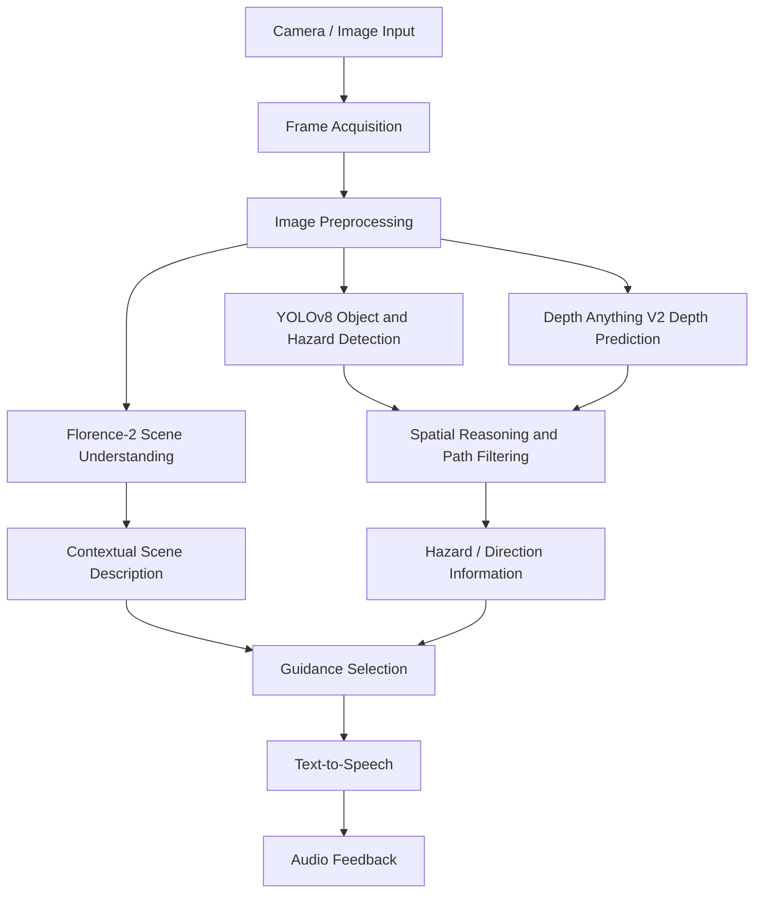

# BlindSight — AI-Powered Assistive Navigation

> **Turning visual information into spoken context for people with visual impairments.**

BlindSight is an assistive-technology project that combines computer vision, monocular depth estimation, vision-language understanding, and speech output to help a user interpret their surroundings. The system is designed around a vision-to-speech pipeline: camera frames are processed, objects and potential hazards are identified, scene context is generated, and relevant information is communicated through audio.

**Repository:** [Saipraneeth-12/BlindSight](https://github.com/Saipraneeth-12/BlindSight)

---

## Contents

- [Problem](#problem)
- [Solution overview](#solution-overview)
- [System architecture](#system-architecture)
- [Core processing pipeline](#core-processing-pipeline)
- [Key capabilities](#key-capabilities)
- [Technology stack](#technology-stack)
- [Repository structure](#repository-structure)
- [Getting started](#getting-started)
- [Configuration and credentials](#configuration-and-credentials)
- [Screenshots and demo](#screenshots-and-demo)
- [Research and evaluation](#research-and-evaluation)
- [Limitations and responsible use](#limitations-and-responsible-use)
- [Future improvements](#future-improvements)
- [Contributing](#contributing)
- [Acknowledgements](#acknowledgements)

---

## Problem

People with visual impairments may need more than object labels to understand a changing environment. Knowing that an object is present is not always enough; useful assistance can also require context about the scene, the approximate location of an obstacle, and an understandable audio description.

BlindSight explores how multiple AI components can work together to transform camera input into contextual spoken feedback.

## Solution overview

BlindSight follows a modular vision-to-speech approach. Its research architecture brings together:

1. **Image acquisition** — obtains visual input from a camera.
2. **Image preprocessing** — prepares frames for downstream analysis through image enhancement operations.
3. **Object and hazard detection** — uses YOLOv8 to identify objects and potential obstacles.
4. **Depth estimation** — uses monocular depth prediction with Depth Anything V2 to estimate relative scene depth.
5. **Scene understanding** — uses Florence-2 to produce natural-language descriptions of the visual scene.
6. **Spatial reasoning** — considers object position and estimated depth to identify potentially relevant hazards and free-space regions.
7. **Speech output** — converts selected descriptions and alerts into audio feedback.

The repository also contains `client`, `server`, and `mcp_server` components. The exact run commands and environment variables should be taken from the configuration files in those directories; they are intentionally not guessed in this document.

## System architecture

The following diagram summarizes the processing flow described in the BlindSight project research. It is a conceptual architecture diagram, not a screenshot of the running application.



### Supporting services

The research design also describes contextual assistant services and an emergency-notification concept. These depend on the corresponding service configuration and external providers. Do not assume that an integration is active in every local setup; verify the relevant implementation and credentials before enabling it.

## Core processing pipeline

### 1. Image acquisition and preprocessing

Camera frames are used as the visual input to the system. Preprocessing can include noise reduction, brightness and contrast adjustment, and frame preparation to improve the quality of downstream analysis.

### 2. Object detection with YOLOv8

YOLOv8 is used to detect objects in a frame and return their bounding-box locations. The research discusses objects such as pedestrians, vehicles, furniture, and other objects that may be relevant to navigation.

### 3. Monocular depth estimation with Depth Anything V2

Depth Anything V2 predicts a depth map from a single RGB image. Depth values within detected object regions can be used to estimate relative proximity. Monocular depth predictions are estimates; they should not be treated as calibrated measurements of real-world distance unless a calibration procedure is implemented and validated for the target camera.

### 4. Scene understanding with Florence-2

Florence-2 is used as a vision-language model to generate a natural-language description of the scene. This provides semantic context that complements object-level detections.

### 5. Spatial reasoning and hazard filtering

The proposed design considers horizontal object position and depth information to reason about left, center, and right regions. It also describes heatmap-based free-space analysis, target tracking, and alert debouncing to reduce repeated notifications.

### 6. Speech feedback

Textual descriptions and selected alerts can be converted into spoken output using a text-to-speech component. The intent is to provide concise, context-aware information without requiring the user to read a visual display.

## Key capabilities

The project research describes the following capabilities. Availability in a particular deployment depends on the corresponding module being present and configured in the repository.

- Camera-based visual input.
- Image preprocessing and enhancement.
- Object and potential hazard detection using YOLOv8.
- Monocular depth estimation using Depth Anything V2.
- Natural-language scene descriptions using Florence-2.
- Spatial reasoning across left, center, and right regions.
- Heatmap-based free-space analysis in the proposed navigation pipeline.
- Target tracking and alert debouncing to reduce repetitive alerts.
- Text-to-speech output for spoken guidance.
- Contextual assistant services and guardian/emergency notification concepts described in the research architecture.

## Technology stack

| Area | Technology / component | Role |
|---|---|---|
| Programming | Python | Core AI and backend development |
| Computer vision | OpenCV | Image and frame processing |
| Object detection | YOLOv8 | Object and potential hazard detection |
| Depth estimation | Depth Anything V2 | Monocular depth prediction |
| Vision-language understanding | Florence-2 | Scene description and semantic understanding |
| Deep learning | PyTorch | Model execution and experimentation |
| Numerical processing | NumPy | Array and numerical operations |
| Web application | Client application in `client/` | User-facing interface |
| Backend | Application in `server/` | Server-side processing and APIs |
| Context services | Components in `mcp_server/` | Contextual tool/service integration, where configured |
| Audio | Text-to-speech component | Spoken descriptions and alerts |

> **Note:** This table reflects the project/research technology choices. Check the source files and dependency manifests for the exact versions and the components enabled in your current checkout.

## Repository structure

The public repository currently exposes these top-level entries:

```text
BlindSight/
├── client/       # Client-side application
├── server/       # Backend application and processing services
├── mcp_server/   # Context/tool service components
└── README.md
```

Additional files and subdirectories may exist inside each component. Refer to their own manifests and source files for the authoritative module layout.

## Getting started

### Prerequisites

The exact prerequisites depend on the client and server manifests in the repository. Before installing, check for:

- Git
- Python and pip, if the backend uses Python
- Node.js and npm, if the client uses a Node-based toolchain
- A camera or sample image/video input for visual testing
- Sufficient memory and compute resources for the selected vision models

### 1. Clone the repository

```bash
git clone https://github.com/Saipraneeth-12/BlindSight.git
cd BlindSight
```

### 2. Inspect the component manifests

Check the files present in each directory before running installation commands:

```bash
# Windows PowerShell
Get-ChildItem -Force
Get-ChildItem .\client -Force
Get-ChildItem .\server -Force
Get-ChildItem .\mcp_server -Force
```

Look for files such as `package.json`, `requirements.txt`, `pyproject.toml`, `.env.example`, or project-specific setup documentation. Install dependencies using the manifest that actually exists.

### 3. Set up the client

If `client/` contains a `package.json`, install its dependencies from that directory:

```bash
cd client
npm install
```

Use the `scripts` section of `client/package.json` to identify the supported development and production commands. For example, run the script documented by the project rather than assuming a particular framework command.

### 4. Set up the backend

If `server/` contains a Python dependency file such as `requirements.txt`, create and activate a virtual environment, then install the listed dependencies:

```bash
cd server
python -m venv .venv
```

Activate it:

```bash
# Windows PowerShell
.\.venv\Scripts\Activate.ps1

# macOS / Linux
source .venv/bin/activate
```

Then, if `requirements.txt` is present:

```bash
pip install -r requirements.txt
```

Use the server's actual entry point and run instructions. The repository's current top-level listing alone does not establish a specific backend start command.

### 5. Configure and start supporting services

If `mcp_server/` is required for the features you want to test, inspect its README, dependency manifest, and environment example. Start it using the documented command and configure the backend to connect to the correct local service address.

### 6. Run the application

Start the backend, any required context service, and the client using the commands defined in their respective manifests/documentation. Keep the terminal output available so that dependency, model-loading, camera-permission, or connection errors can be diagnosed.

> **Why are the commands not fully hard-coded here?** The public repository view exposes the `client/`, `server/`, and `mcp_server/` directories, but the exact entry points and dependency manifests have not been verified for this README. Replace this section with the tested commands from your local project before presenting the repository as turnkey-installable.

## Configuration and credentials

Some optional services may require API credentials or provider configuration. Follow these practices:

1. Use a local `.env` file for secrets if the application expects environment variables.
2. Provide a sanitized `.env.example` containing variable names and placeholder values only.
3. Never commit API keys, access tokens, passwords, private URLs, or personal contact details.
4. Document which integrations are optional and which are required to launch the core application.
5. If an emergency messaging provider or location service is configured, test it with non-emergency test data and obtain appropriate consent.

Example placeholder format (replace the variable names with the ones actually read by the code):

```env
# Example only — use the variable names required by your implementation.
SERVICE_API_KEY=your_key_here
SERVICE_BASE_URL=http://localhost:8000
```

Do not copy this example into production without checking the code's configuration requirements.

## Screenshots and demo

Add genuine screenshots from your running application to the `assets/` directory. The image paths below are recommended names; create the files and update the Markdown if you choose different names. No placeholder image is embedded as if it were a real application screenshot.

### 1. Main application interface

Show the actual client screen, including the camera/input area and the controls available to the user.

```markdown

```

### 2. Object detection and hazard localization

Use a real frame processed by your application with YOLOv8 detections and bounding boxes visible.

```markdown

```

### 3. Depth estimation output

Show the actual depth map or depth visualization generated by the configured Depth Anything V2 pipeline.

```markdown

```

### 4. Scene description and voice feedback

Show a real Florence-2 scene description and, if available, the corresponding audio/voice-feedback interface. Do not include private user data in screenshots.

```markdown

```

### 5. End-to-end demonstration

Add a short demonstration video or an animated GIF showing the real input-to-output flow. If the video is hosted elsewhere, link to it here.

```markdown
[Watch the BlindSight demonstration](ADD_YOUR_DEMO_LINK_HERE)
```

**Suggested assets folder:**

```text
BlindSight/
├── assets/
│   ├── blindsight-dashboard.png
│   ├── object-detection.png
│   ├── depth-estimation.png
│   └── scene-description.png
```

Only add images that show the implemented application. The architecture diagram above can be used as a conceptual visual until application screenshots are available.

## Research and evaluation

BlindSight's research paper, titled **“BlindSight: Real-Time Image Captioning and Speech Synthesis for Assistive Navigation of the Visually Impaired,”** describes evaluations using the Flickr8k and MS COCO image-captioning datasets and comparisons across image-captioning, object-detection, and depth-estimation models.

### Image-captioning comparison

The paper reports the following Florence-2-Large results on MS COCO:

| Metric | Reported result |
|---|---:|
| BLEU | 0.2980 |
| METEOR | 0.4910 |
| ROUGE-L | 0.5610 |
| CIDEr | 1.0200 |
| Average inference time | 0.4020 (as reported in the paper) |

### Object-detection comparison

| Model | mAP50 | mAP50–95 | Precision | Recall | Inference time (as reported) |
|---|---:|---:|---:|---:|---:|
| YOLOv5 | 0.594 | 0.429 | 0.677 | 0.547 | 0.1020 |
| YOLOv8 | 0.613 | 0.448 | 0.684 | 0.562 | 0.1050 |

### Depth-estimation comparison

| Model | AbsRel | RMSE | MAE | δ1 | δ2 | δ3 | FPS |
|---|---:|---:|---:|---:|---:|---:|---:|
| Depth Anything V2 | 1.02 | 71.78 | 63.70 | 0.20 | 0.34 | 0.47 | 16.33 |
| Depth Anything V1 | 1.04 | 71.89 | 63.87 | 0.19 | 0.33 | 0.47 | 17.69 |
| MiDaS DPT-Large | 0.83 | 58.86 | 52.58 | 0.23 | 0.39 | 0.54 | 2.64 |

These values are reproduced from the supplied research paper and are not independent guarantees of performance on every camera, device, environment, or live deployment. Preserve the paper's evaluation setup when reporting or comparing these results. In particular, do not interpret monocular depth outputs as guaranteed metric distances without camera-specific calibration and validation.

## Limitations and responsible use

BlindSight is an assistive-technology research and development project. It is **not a certified mobility aid, medical device, or replacement for a white cane, guide dog, trained mobility support, or human assistance**.

- Object detectors can miss objects or produce false detections.
- Depth estimation can be affected by lighting, texture, camera properties, occlusion, and scene complexity.
- Scene descriptions may omit important details or generate inaccurate interpretations.
- Processing latency, network availability, camera access, and hardware capability can affect responsiveness.
- Audio guidance should not be treated as a guarantee that a path is safe.
- Emergency messaging or location sharing must be explicitly configured, tested, and used with consent; do not assume it is enabled by default.

Test in controlled environments first and maintain established mobility practices. Never rely on this prototype alone when crossing roads, using stairs, or navigating hazardous areas.

## Future improvements

Potential areas for further development include:

- Improve robustness under low-light, crowded, and fast-changing conditions.
- Evaluate latency and model performance on target hardware.
- Add user-configurable speech verbosity and alert frequency.
- Expand multilingual speech support.
- Improve calibration and validation of distance estimation.
- Add automated tests for API, perception, and client workflows.
- Improve accessibility of the interface and setup documentation.

These are proposed improvements, not claims about currently implemented functionality.

## Contributing

Contributions, bug reports, and suggestions are welcome.

1. Fork the repository.
2. Create a feature branch: `git checkout -b feature/your-change`.
3. Make and test your changes.
4. Commit with a clear message: `git commit -m "Describe your change"`.
5. Push the branch and open a Pull Request describing the change and how it was tested.

For substantial changes, open an issue first to discuss the approach. Do not include private data, credentials, or unlicensed datasets in contributions.

## Acknowledgements

BlindSight builds on research and open-source work in computer vision, object detection, monocular depth estimation, vision-language models, and assistive technology. The project research discusses YOLOv8, Depth Anything V2, Florence-2, Flickr8k, and MS COCO.

## Contributors

- **Sai Praneeth Kummari** — [GitHub](https://github.com/Saipraneeth-12)

Please update this section to acknowledge all project collaborators and their contributions accurately.

## License

No license has been specified in this README. Add a `LICENSE` file only after choosing a license that you have the right to apply to the project and its included code/assets. Until then, the repository's reuse terms should not be assumed to be permissive.

---

<p align="center">
  Built to explore more accessible ways of understanding the world through AI.
</p>
